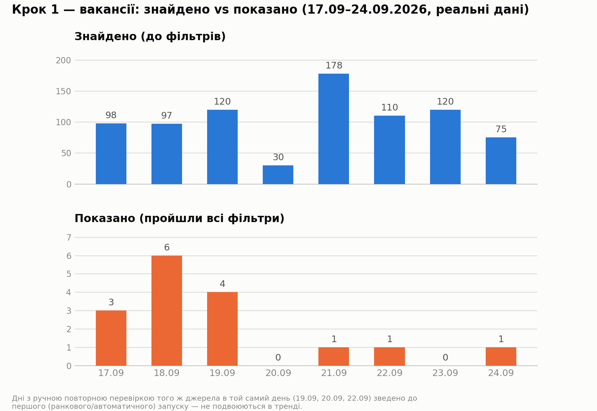
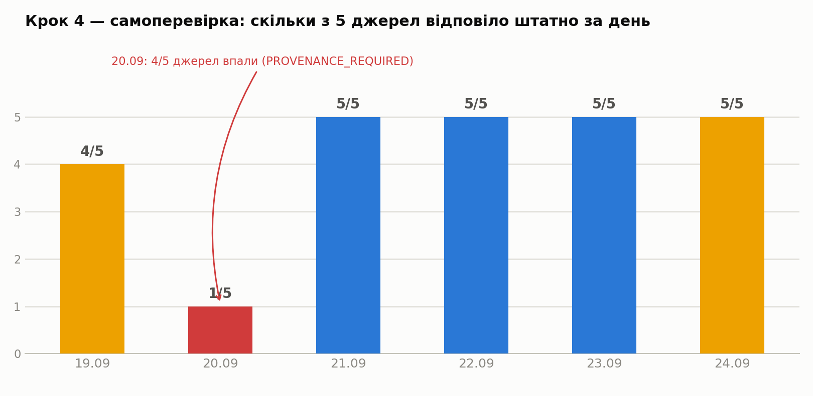

# Реальні дані щоденного запуску (17–24.09.2026)

## Що це і звідки

Це не приклад, не мокап — це реальний робочий журнал щоденної автоматизації
пошуку роботи за 8 днів поспіль, взятий напряму з трьох службових Google-таблиць
("Результат щоденної перевірки", "Метрики автопошуку вакансій", "Метрики
автопошуку фріланс-проєктів").

**Важливе уточнення щодо джерела.** Цей розбір стосується **першого етапу
(17–24.09.2026)**, коли працювала лише текстова версія промпту: рядки в трьох
таблицях писав "мозок" системи — Claude, що виконує щоденну scheduled-задачу з
доступом до вебу через інструмент типу WebFetch (та сама "текстова версія", яку
описує вступ до `README.md`). `config.py` навмисно вказує на ТІ САМІ назви
службових файлів ("Результат щоденної перевірки" тощо), щоб типізований
Python-пайплайн продовжив саме цей журнал — той самий формат рядків, той самий
контракт полів (`SELFCHECK_HEADER`, `METRICS_HEADER`, `FREELANCE_METRICS_HEADER`
у `models.py`).

**З 25.09.2026 той самий контракт виконує `python main.py`** — щоденний запуск
на ПК власника (Windows Task Scheduler). Дані за місяць (воронка, збої, вартість)
— у [README, розділ «Приклад реального запуску»](../README.md#приклад-реального-запуску);
хронологія змін — у [docs/CHANGELOG.md](CHANGELOG.md). Кількість і стан тестів
показує CI-бейдж у README.

Нижче — доказ того, що бізнес-логіка, яку типізує й покриває тестами цей
репозиторій, приймала реальні рішення на реальних даних ще до першого запуску
Python-коду. Цифри цього розділу — зріз 17–24.09, не поточний стан.

## Крок 1 — вакансії: знайдено vs показано

Конверсія "показано/знайдено" тримається в діапазоні 0–6% — і це очікувано,
не помилка фільтра: профіль кандидата (Junior/без досвіду, повний remote,
ЗП від порогу з `config.MIN_SALARY_UAH`, англійська до `config.MAX_ENGLISH_LEVEL`)
відсікає переважну більшість ринку за задумом. 20.09 і 23.09 — показові дні:
0 показаних не через збій, а тому що жодна з реально знайдених вакансій не
пройшла критерії (23.09: повне 5/5 покриття джерел, справжній нуль).

## Крок 4 — самоперевірка: чи можна довіряти цифрам вище

Це і є вся причина існування Кроку 4: 20.09 чотири з п'яти джерел одночасно
відповіли відмовою доступу (PROVENANCE_REQUIRED — інструмент вебдоступу не
міг підтвердити дозвіл без живого користувача в автономному запуску). Без
Кроку 4 це виглядало б як "сьогодні просто мало вакансій". З Кроком 4 —
чітко видно: це не ринок сплющився, це джерела недоступні, і тренд того дня
свідомо позначений непорівнянним із сусідніми. Наступного ранку (21.09) —
повне відновлення, 5/5.

## Крок 1.2 — фріланс: чесний нуль, а не тиша

За всі 3 дні, відколи Крок 1.2 активний (22–24.09), показано 0 релевантних
фріланс-проєктів по обох категоріях Freelancehunt і 0 по Telegram-каналу.
Це не мовчазний збій — власний сигнал системи ("дні поспіль з 0") це фіксує
явно: 3 дні поспіль для BI/SQL-категорій, 2 для Telegram-каналу, на момент
24.09. Поріг перегляду — `FREELANCE_ZERO_STREAK_REVIEW_THRESHOLD = 7` — ще
не досягнуто, тому це поки що спостереження, не сигнал "джерело зламане".
Якщо стрік дійде до 7 — це буде явний привід переглянути критерії
релевантності чи сам вибір категорій, а не тихо змиритися з порожнім
результатом.

## Кілька реальних рішень із журналу

За ці 8 днів система самостійно виключила вакансію "Data Analyst Trainee
Junior" (Ideal, robota.ua) **тричі поспіль** (21.09, 22.09, 23.09) — вона
щоразу повертається у видачу, і щоразу застосовується те саме правило,
встановлене 21.09 (підозра на MLM-подібну схему: оплата $500/тиждень +
непрозорі бонуси, вимога громадянства України, відсутність реальних
технічних вимог). Окремо виявлена й задокументована системна проблема
достовірності дат на robota.ua/work.ua — мітки на кшталт "16 годин тому" у
списку вакансій розходились із фактичною датою на сторінці самої вакансії
(в одному випадку — на 20 днів); це підтвердилось на рівні і списку, і
окремої картки, і тепер враховується як відоме джерело шуму, а не
поодинокий збій.

## Як це продовжилось у Python-версії

Із 25.09.2026 `python main.py` (`requests` + BeautifulSoup/`curl_cffi` замість
WebFetch, детермінований підрахунок у Python замість "лічильників по ходу")
щодня пише рядки в ті самі таблиці — окремою копією з суфіксом " (тест гітхаб)"
на час паралельного A/B-звірення з чат-версією (README, «Тестовий режим»).
Перша ж реальна проблема, яку виявив цей паралельний запуск, описана в README
(«Як перевіряється вивід AI»): 27.09 Python-версія показала 8 вакансій, з яких
0 виявились релевантними — і це змінило логіку оцінки для обох версій.
